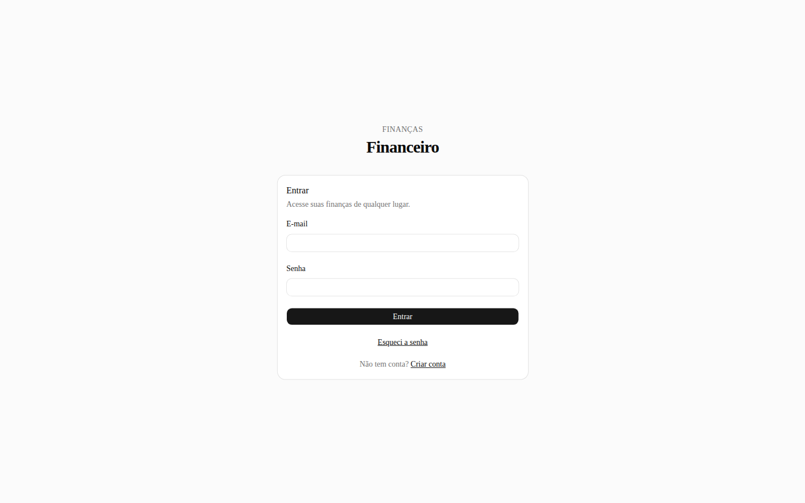
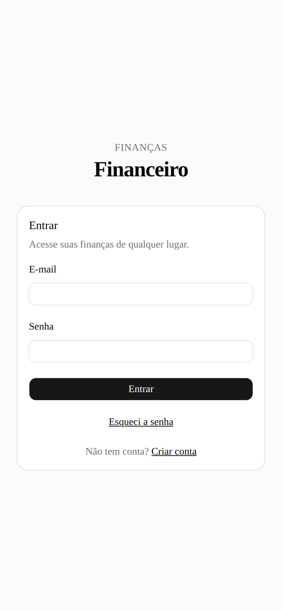
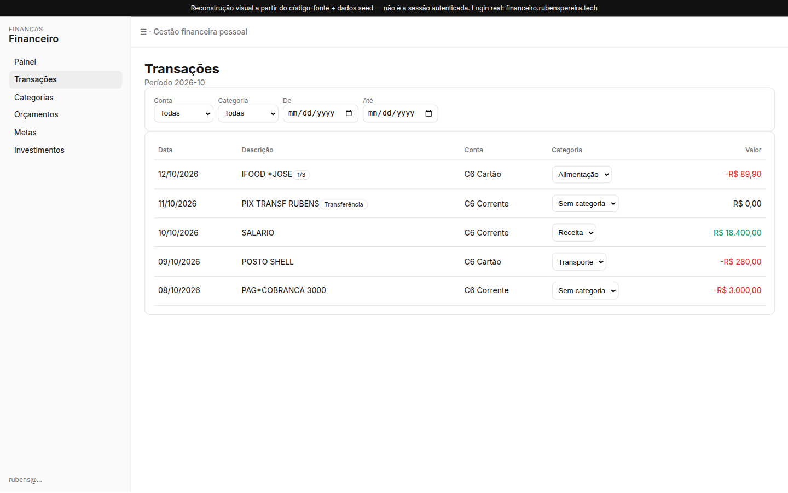
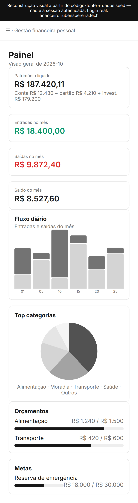
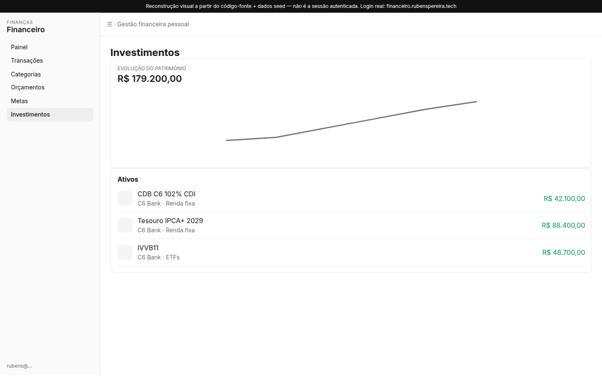
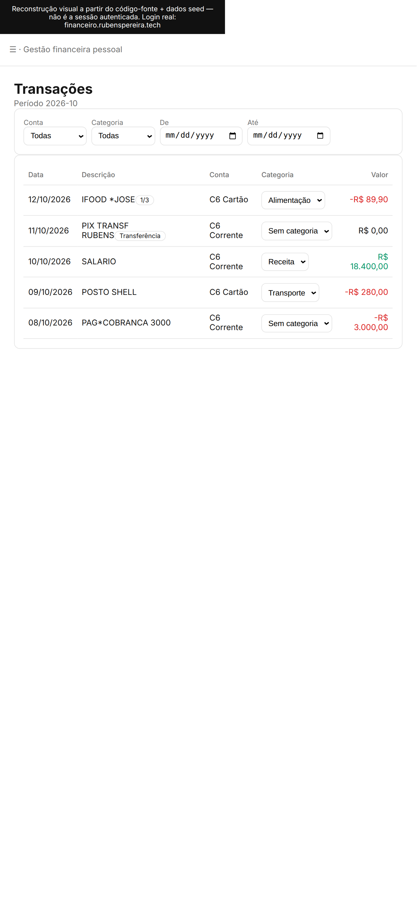
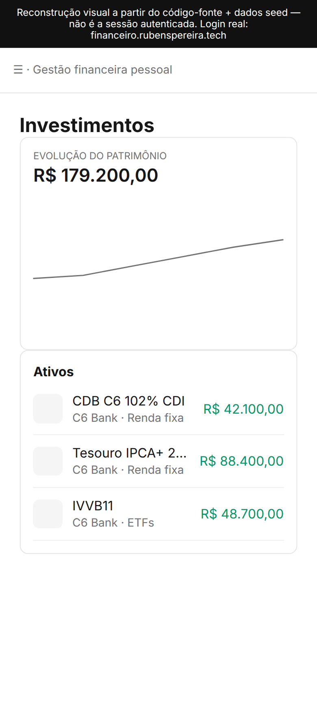

# Plano de evolução — Financeiro

> Spec de produto (fase Superpowers `brainstorming`) + roadmap priorizado (fase `writing-plans`, granularidade de fatia — não de passo TDD).
>
> **Código da app não muda neste PR.** Trabalho de implementação começa **depois** do merge do [PR #1](https://github.com/rubenscpneto/financeiro/pull/1) (`feat/drizzle-better-auth`). Cada fatia do MVP deve ganhar um plano em `docs/superpowers/plans/` na hora de executar.
>
> Screenshots: `docs/screenshots/`. Login é captura real de `financeiro.rubenspereira.tech`. Telas internas são reconstrução visual a partir do código-fonte + dados seed (sem sessão autenticada neste ambiente).

---

## 1. Intent

App pessoal de finanças do Rubens (Brasil, UI pt-BR). Já puxa C6 Bank via Open Finance (Meu Pluggy). Ficou parado; o dono não gosta do UX/UI atual e quer um salto: **mobile-first, excelente no desktop**, útil no dia a dia para decidir gasto, ver anomalia e conversar com os dados — sem virar SaaS.

Diferencial: não competir com Mobills/Organizze. É um **cockpit privado na VPS do dono**, com JEV (vale a pena?) e Hermes (agente que consome a API/MCP), dados que não saem da casa.

**Sucesso:** abrir no celular e em 5 segundos saber saldo, fatura, o que estourou o orçamento e se um gasto de R$ 3.000 é estranho — sem tabela Excel com sidebar.

---

## 2. Goals / non-goals / anti-goals

### Goals

- Painel mobile que cabe no polegar; desktop que usa a largura (não só estica a tabela).
- Sync Pluggy confiável no modelo Meu Pluggy (sem `PATCH /items`).
- Categorias, orçamentos e metas que o dono realmente usa.
- JEV no fluxo de decisão de compra; Hermes com leitura segura dos dados.
- Infra alinhada ao padrão da casa: Coolify + Postgres + Drizzle + pgweb. Sem Supabase.

### Non-goals (agora)

- Multi-usuário / família / sharing.
- Cadastro aberto (`disableSignUp: true` permanece).
- Open Finance de outros bancos além do que já está no Meu Pluggy (autorizar banco novo é no Meu Pluggy, não no app).
- Payment initiation / PIX via Pluggy.
- Substituir Meu Pluggy ou o app do C6.

### Anti-goals

- Mandar extrato completo para LLM na nuvem sem redaction.
- Cron que chama `PATCH /items` (Meu Pluggy **proíbe** update manual do proxy Item).
- Reintroduzir Supabase, RLS como segurança principal, ou Vercel como runtime.
- Redesign que troca shadcn/Tailwind por outro kit sem ganho.
- “AI everywhere” com custo por transação.

---

## 3. Constraints (baseline)

Arquitetura-alvo = **PR #1**, não o `main` com Supabase.

| Constraint | Valor |
| --- | --- |
| Runtime | Coolify 4.4.3, Docker, Ubuntu 24.04, 16 GB RAM, portas **22/80/443** |
| Prod | `https://financeiro.rubenspereira.tech` |
| Staging | `https://staging-financeiro.rubenspereira.tech` |
| DB | Postgres + Drizzle (`postgres` driver). **Sem Supabase.** Autorização por `user_id` no server (`requireUser()` + `assert*Owned`). |
| Auth | Better Auth, email+senha, signup off, bcrypt legado + scrypt novo |
| Arquivos | `STORAGE_DIR` (default `/data/statements`), volume Docker uid 1000 |
| Open Finance | Item Meu Pluggy. Refresh a cada ~24h no Meu Pluggy. **Proxy Item não aceita `PATCH`.** Webhooks funcionam. |
| Sync app | Cron Coolify 13h BRT → `GET /api/cron/pluggy-sync` + webhook `item/created` \| `item/updated` |
| Vizinhos na VPS | Hermes `hermes.rubenspereira.tech`, `jev-gateway` interno, `vps-monitor` + Telegram |
| UI | Next.js 16 App Router, React 19, Tailwind 4, shadcn/ui (`base-nova`, lucide), `lang=pt-BR`, `America/Sao_Paulo` |
| Processo | Superpowers em `.cursor/skills/`. Fatias futuras: TDD + `writing-plans`. |

`AGENTS.md` no `main` ainda descreve Supabase/Vercel. Atualizar **depois** do merge do PR #1 (não neste PR).

---

## 4. Auditoria — o que existe hoje

### 4.1 Superfície

| Rota | Status | Notas |
| --- | --- | --- |
| `/auth/login` | viva | Card central, pouco mobile |
| `/auth/cadastro` | viva, inútil no PR #1 | Signup disabled |
| `/auth/esqueci-senha` | viva, oca | Resend só se `RESEND_API_KEY` |
| `/painel` | viva | KPIs + gráficos + resumo orçamento/meta |
| `/transacoes` | viva | Tabela até 1000 linhas, filtro mês/conta/categoria |
| `/categorias` | viva | CRUD + regras `description.includes(pattern)` |
| `/orcamentos` | viva | Limite mensal por categoria; **não rola para o mês seguinte** |
| `/metas` | viva | `current_amount` **manual**, não amarra conta/investimento |
| `/investimentos` | viva | Evolução + lista de ativos + movimentos aporte/resgate |
| `/contas`, `/importar` | **redirect → `/painel`** | UI morta; parsers C6 (CSV/OFX/PDF/ZIP) **ainda existem** em `src/lib/parsers/` e `import.ts` |
| `/api/cron/pluggy-sync` | viva | Bearer `CRON_SECRET` |
| `/api/webhooks/pluggy` | viva | Bearer `PLUGGY_WEBHOOK_SECRET`; só `item/created` e `item/updated` |

Nav (`app-shell.tsx`): Painel, Transações, Categorias, Orçamentos, Metas, Investimentos. Sem busca, sem Configurações, sem status de sync.

### 4.2 Modelo de dados (Drizzle / PR #1)

```
user / session / account / verification     Better Auth
profiles                                    locale pt-BR, timezone America/Sao_Paulo
accounts                                    checking | credit_card | investment + pluggy_account_id
categories                                  income | expense | transfer
category_rules                              match_pattern, priority, account_type?
transactions                                amount numeric(14,2), external_hash unique (user_id, hash)
imports                                     pending|parsed|committed|failed, file_path disco
budgets                                     unique (user, category, year_month YYYY-MM)
goals                                       current_amount manual
investment_positions                        is_active, amount_original/withdrawal, rate
investment_movements                        aporte|resgate|provento|outro
balance_snapshots                           PK (user_id, account_id)
```

Lacunas de modelo (não inventar tabela antes da fatia):

- Sem `subcategory`, sem split, sem recorrência, sem merchant_id.
- Sem histórico de saldo (snapshot é **último valor**, não série).
- Sem `webhook_events` / idempotência por `eventId`.
- Sem `ai_evaluations` / `insights`.
- Metas não têm `account_id` / regra de contribuição.
- Orçamento não tem rollover nem alerta.

### 4.3 Pluggy sync

**Como é (correto em parte):**

- Credenciais só no backend (`PLUGGY_CLIENT_*`).
- `GET /items/{id}` + `assertItemReady` (bloqueia LOGIN_ERROR / OUTDATED / WAITING_*).
- Paginação de accounts/investments; transações via cursor `/v2/transactions`.
- Upsert por `external_hash`; contas e posições stale → `is_active=false`.
- Categoriza: `source_category` Pluggy, depois regras locais.
- Cron diário (não `PATCH`). Webhook ack rápido + `after()` para o pull.

**Problemas vs docs oficiais** ([Webhooks](https://docs.pluggy.ai/docs/webhooks), [Item / Meu Pluggy](https://docs.pluggy.ai/en/docs/connections/item)):

| # | Achado | Impacto |
| --- | --- | --- |
| 1 | Webhook **ainda aponta para Vercel** | Eventos de sync do Meu Pluggy não chegam na VPS |
| 2 | Só escuta `item/created` e `item/updated` | Ignora `item/error`, `waiting_user_*`, `transactions/created\|updated\|deleted` |
| 3 | Em `item/updated` **refetcha todas as transações** desde `PLUGGY_TXN_DATE_FROM` (default 90 dias) | Não usa `createdTransactionsLink`; caro e atrasa merge/delete |
| 4 | Sem tabela de `eventId` | Retry do Pluggy pode reprocessar |
| 5 | Sync é “admin” via `PLUGGY_SYNC_USER_ID` | Ok para app 1-user; vazar o cron = escreve na conta certa, mas é a única |
| 6 | UI **não mostra** `status`, `lastUpdatedAt`, próxima sync | Dono não sabe se está stale |
| 7 | `GET /v2/items` não existe para conta Meu Pluggy | Já usam `PLUGGY_ITEM_ID` fixo — manter |
| 8 | “Atualizar agora” **não pode** ser `PATCH` | Só: esperar 24h, ou o dono refresh no Meu Pluggy, ou puxar GET de novo se o proxy já espelhou |

Default de 90 dias: histórico antigo depende do import C6 (parsers vivos, UI morta).

### 4.4 Auth / segurança (pós PR #1)

- RLS some. Toda query **tem** que filtrar `user_id`. Um `.from(transactions)` sem where é vazamento. Review focus permanente.
- `src/proxy.ts` só olha **cookie presente**, não sessão válida. Páginas usam `requireUser()` — ok, mas cookie lixo redireciona mal.
- Signup off. Reset de senha morto até Resend.
- Cron/webhook públicos na 443: secret no `Authorization`. Sem IP allowlist Pluggy (`52.67.145.81`) — firewall da VPS não ajuda (só 80/443). Rate-limit no Coolify/proxy vale a pena.

### 4.5 UI/UX (evidência)

**Login real, 1440px** — card centrado, muito vazio, marca genérica “Finanças / Financeiro”, sem last-sync, sem PWA.



**Login real, 390px** — card estoura viewport, padding grande, teclado vai esconder o submit. Não é mobile-first.



**Painel (reconstrução 1440)** — 4 KPIs + 2 charts + 2 listas. Desktop ok, mas visual “dashboard shadcn default”: cinza, pie sem legenda útil, fluxo diário ilegível com muitos dias.



**Painel 390** — cards empilham (bom). Sidebar some (Sheet existe no componente, mas o hábito é hamburger genérico). Sem bottom nav. Gráfico de barras em 390 é ruído.



**Transações 1440** — tabela admin. Filtros nativos `<select>`, categoria inline por linha (bom), sem busca, sem merchant, sem “vale a pena?”.



**Transações 390** — tabela larga; horizontal scroll. Padrão que o dono já odeia.



**Investimentos 1440** — melhor tela (evolução + accordion). Ainda cinza, ícone genérico, sem alocação por classe.



Achados transversais:

- Tokens dark existem em `globals.css`; **não há ThemeProvider / toggle**. `next-themes` está no `package.json` do `main` e some no PR #1 (`components.json` drop).
- Sem `manifest`, service worker, `viewport` theme-color, apple-touch-icon. **Não é PWA.**
- A11y: `<select>` nativo fora do design system; contraste emerald/red ok; sem skip-link; tabelas sem caption; login sem `autocomplete` issues graves (email/password ok).
- Contas: filtro no painel, mas **não há tela de contas** (rota redireciona).
- Import: código vivo, UX morta — se Pluggy atrasar, o dono não tem fallback na UI.

---

## 5. Pesquisa — o que copiar

Prioridade = valor para **um usuário BR, C6 + investimentos, self-host**.

| # | Feature | De | Por quê | Quando |
| --- | --- | --- | --- | --- |
| P0 | Home “hoje”: saldo, fatura, gasto do mês, 3 alertas | Copilot, PicPay Minhas Finanças | Abre o app com pergunta respondida | MVP |
| P0 | Lista de transações estilo extrato (card), não tabela | Organizze, Mobills | Mobile | MVP |
| P0 | Status de conexão + “atualizado há …” | Meu Pluggy, Monarch | Confiança no Open Finance | MVP |
| P0 | Orçamento com % e cor (estourou / perto) | YNAB/Mobills | Já existe o dado; falta o feedback | MVP |
| P1 | Regras de categoria + “aplicar em todas iguais” | YNAB, Monarch | Regras já existem; falta UX de correção em massa | MVP |
| P1 | Anomalia (gasto >> mediana da categoria) | Copilot Insights | R$ 3.000 sem drama de LLM | MVP |
| P1 | JEV “vale a pena?” no detalhe da txn / pré-compra | próprio | Decisão, não dashboard | MVP |
| P1 | Contas + fallback import C6 | Mobills OFX | Parsers já estão no repo | Next |
| P1 | Insights do mês (1 card, 5 bullets) | Copilot weekly recap | 1 chamada LLM/mês | Next |
| P1 | Q&A NL + MCP Hermes (read-only) | Organizze MCP, Monarch Ask | Hermes já está na VPS | Next |
| P2 | Recorrentes / assinaturas | Copilot, Pluggy enrichment | Evita surpresa | Next |
| P2 | Rollover de orçamento + envelope | YNAB | Só se o dono quiser disciplina zero-based | Later |
| P2 | Alocação de carteira por classe + meta | Monarch/Empower light | Investimentos já são o ponto forte | Next |
| P2 | Meta ligada a conta/posição | Mobills | Hoje o progresso é digitado | Next |
| P2 | Export CSV / OFX out | Mobills | Backup humano | Later |
| — | WhatsApp bot | Mobills PRO | Hermes/Telegram já cobrem; não duplicar | Later/não |
| — | Household sharing | Monarch | Anti-goal | Não |
| — | Merchant logos / enrichment pago Pluggy | Pluggy premium | Custo; merchant text já vem | Later |

Meu Pluggy em si: carteira de dados + API/MCP. Este app deve ser a **camada de julgamento** (orçamento, JEV, anomalia), não um clone do dashboard Pluggy.

---

## 6. IA — touchpoints e arquitetura

### 6.1 Onde entra

| Touchpoint | Motor | Trigger | Dado que entra | Saída |
| --- | --- | --- | --- | --- |
| Vale a pena? | **JEV** (`jev-gateway` interno) | Tap no detalhe / composer “quero comprar X por R$ Y” | amount, merchant, category, gasto_mês, limite, saldo, opcional contexto | verdict + reasons[] |
| Alerta de orçamento | regras | pós-sync | spent/limit | push interno / Telegram via vps-monitor |
| Anomalia R$ 3.000 | regras (+ JEV se o dono pedir) | pós-sync | amount vs p90 categoria / vs mediana 90d | card no painel |
| Categorizar | regras → Pluggy `category` → LLM só gap | sync / correção | description, amount, account_type | category_id + “aplicar em semelhantes” |
| Insight mensal | LLM local ou gateway | 1×/mês ou tap | agregados, **não** lista raw | 5 bullets |
| Q&A | Hermes via MCP | chat Hermes | tools read-only | texto |
| Roteamento | JEV | qualquer pedido ambíguo | intent | `jev` \| `rules` \| `hermes` \| `noop` |

### 6.2 Arquitetura (chamada do autor)

Tudo na **rede Docker interna**. Nada de JEV/Hermes na internet com o Postgres.

```
[Coolify]
  financeiro-app ──Postgres
       │
       ├─ POST /api/ai/jev        → jev-gateway:internal
       ├─ GET  /api/ai/insights   → job mensal (agregados)
       └─ MCP : /mcp (streamable HTTP, auth token)
              → Hermes (hermes.rubenspereira.tech) só na overlay interna
  vps-monitor → Telegram (orçamento/anomalia/sync fail)
```

**MCP tools (read-only no MVP):** `get_net_worth`, `list_transactions({from,to,q,limit})`, `get_budget_status(month)`, `list_investments`, `get_sync_status`. Write (`recategorize`) só depois de auth forte e allowlist do Hermes.

**Não** expor MCP na 443 pública sem token + mTLS/allowlist. Porta da VPS já é só 80/443 — o MCP pode viver em path `/mcp` no mesmo host, mas **não** indexável, Bearer obrigatório.

### 6.3 Privacidade

- Default: dado **não sai da VPS**. JEV e Hermes são vizinhos.
- Se algum modelo for cloud: payload mínimo (sem `last4`, sem descrição crua se possível, amounts arredondados, sem CPF). Logar o payload redacted.
- LGPD: é dado do próprio dono; mesmo assim, volume `STORAGE_DIR` tem extrato PDF — backup offsite **criptografado**.
- Prompt/insight: guardar em `ai_runs` (prompt hash, tokens, verdict) para auditoria de custo — sem gravar extrato inteiro.

### 6.4 Custo

| Caminho | Custo esperado |
| --- | --- |
| Regras (orçamento, anomalia, categoria) | ~0 |
| JEV por tap | barato se interno; **não** chamar no sync de 500 txns |
| Insight mensal | 1 chamada, contexto < 4k tokens de agregados |
| Q&A Hermes | por pergunta; cache 5 min da mesma query |
| LLM categorizar | só `category_id IS NULL` em lote noturno, cap N/dia |

Cap: se `jev-gateway` cair, a UI mostra o gasto **sem** bloquear. AI é helper, não source of truth.

---

## 7. Direção de design

### 7.1 Information architecture

```
(mobile bottom nav — 5)
  Hoje | Movimentos | Investir | Orçar | Mais

Hoje          = painel redesenhado (saldo, fatura, mês, alertas, JEV recente)
Movimentos    = transações card + busca + filtro
Investir      = posições + evolução (já existe)
Orçar         = orçamentos do mês + metas (hoje separados)
Mais          = categorias/regras, contas, import, sync, senha, tema, export

Desktop: sidebar (já existe) com os mesmos destinos + painel wide (KPI + chart + feed).
```

Unir Orçamentos+Metas no mobile; manter rotas `/orcamentos` e `/metas` no desktop se útil.

### 7.2 Telas-chave (MVP)

1. **Hoje** — patrimônio, conta, fatura, gasto vs orçamento, 0–3 alertas, “atualizado há 6h · Meu Pluggy”.
2. **Movimento (detalhe)** — merchant, parcela, conta, categoria, botão **Vale a pena?**, marcar transferência, nota.
3. **Lista movimentos** — cards; swipe ou tap para categoria.
4. **Investir** — manter evolução; adicionar donut por `asset_class`.
5. **Sync/contas** — status Item, última sync, CTA “abrir Meu Pluggy” (não PATCH).
6. **Login** — compacto no mobile, `autocomplete`, link reset só se Resend on.

### 7.3 Design system

- **Manter** shadcn/ui + Tailwind 4 + lucide. Não migrar kit.
- Trocar `base-nova` cinza por paleta com **1 accent** (sugestão: verde dinheiro sóbrio, não emerald gritante em tudo) + semantic: success/danger/warning.
- Tipografia: Geist já está; números `tabular-nums` + `formatBRL` (já existe).
- Componentes a adicionar: `TxnRow` (card), `Money`, `SyncBadge`, `BudgetBar`, `JevVerdict`, bottom-nav.
- Dark mode: `next-themes` + class `.dark` (tokens já prontos). Default: system.
- Charts: Recharts ok; no mobile, **1 série** ou sparkline, não bar 30 dias.

### 7.4 Acessibilidade

- Alvo 44px no mobile (inputs hoje `h-8`).
- Substituir `<select>` nativo por `Select` shadcn nas listas longas; nativo ok em filtros simples.
- Foco visível já vem do shadcn; testar teclado no detalhe da txn.
- `lang=pt-BR` ok. Contraste dos KPI red/emerald no dark: verificar WCAG AA.
- Tabelas: no mobile viram lista; não só `overflow-x`.

### 7.5 PWA

- `manifest.webmanifest` + ícones 192/512, `display=standalone`, `theme-color`.
- `apple-web-app-capable`.
- Service worker **só shell** (não cachear dados financeiros). Next 16: `@serwist/next` ou `next-pwa` — avaliar na fatia; se brigar com `output: "standalone"`, gerar SW na imagem Docker.
- Instalar na home do Android/iOS = vitória do mobile-first.

---

## 8. Infra — gaps para o roadmap

Já na VPS (contexto do dono): prod, staging, cron 13h BRT, backup **local** do Postgres, Hermes, jev-gateway, vps-monitor.

Pendências:

| Gap | Risco | Fatia |
| --- | --- | --- |
| Webhook Pluggy ainda no Vercel | Sync só no cron (atraso até 24h; perde item/error) | MVP-infra |
| Sem SMTP / Resend | Esqueci senha inútil | MVP-infra |
| Backup só local; **volume de statements fora** | Perda de PDF/CSV na falha de disco | MVP-infra |
| vps-monitor não observa `financeiro` | App cai e Telegram cala | MVP-infra |
| Sem offsite (B2/R2/S3) | VPS Hostinger = SPOF | Next |
| pgweb na stack (padrão da casa) | Debug SQL; **não** expor 443 sem auth | Next |
| `AGENTS.md` ainda fala Supabase | Agentes futuros erram o stack | chore pós PR #1 |

Webhook: `https://financeiro.rubenspereira.tech/api/webhooks/pluggy` + header `Authorization: Bearer $PLUGGY_WEBHOOK_SECRET`. Eventos: `item/*` e `transactions/*`. Responder 2xx < 5s (já fazem `after()`).

---

## 9. Roadmap

Estimativa = esforço de agente/dev em horas, não calendário. **S < 4h, M 4–12h, L 12–24h, XL 24h+.**

Código só **após merge do PR #1** (e o fix de `pdf-parse` naquela branch). Este plano não toca `feat/drizzle-better-auth`.

### MVP — “dá para viver no celular”

| ID | Fatia | Esforço | Done when |
| --- | --- | --- | --- |
| M0 | Merge PR #1 + pdf-parse; atualizar `AGENTS.md` (Postgres/Drizzle/Coolify) | S | Login Better Auth no prod |
| M1 | Webhook → VPS; eventos `item/error` + `transactions/*`; tabela `webhook_events(event_id)` | M | Pluggy bate na VPS; retry idempotente |
| M2 | Backup: dump Postgres + tar `STORAGE_DIR` → offsite criptografado; vps-monitor no container financeiro | M | Restore testado 1×; alerta Telegram se health fail |
| M3 | Resend + `EMAIL_FROM` (reset senha) | S | Fluxo esqueci-senha no staging |
| M4 | IA Hoje + bottom nav + TxnRow mobile; login compacto; SyncBadge | L | 390px usável sem scroll horizontal |
| M5 | Detalhe da transação + regras “aplicar em semelhantes” | M | Recategorizar 1 merchant em lote |
| M6 | Anomalia por regras + alerta orçamento (Telegram) | M | R$ 3.000 gera card/alerta |
| M7 | JEV: `POST /api/ai/jev` + botão no detalhe; timeout/fail-open | M | Tap devolve verdict sem vazar PII |
| M8 | PWA mínimo (manifest + ícones + standalone) | S | “Adicionar à tela inicial” |

**Fora do MVP:** MCP Hermes, insight LLM, import UI, dark mode, donut de alocação.

### Next

| ID | Fatia | Esforço |
| --- | --- | --- |
| N1 | MCP read-only + token para Hermes | M |
| N2 | Insight mensal (agregados → LLM) | M |
| N3 | Ressuscitar `/importar` + `/contas` (parsers C6) | L |
| N4 | Dark mode + paleta accent | S |
| N5 | Recorrentes (heurística descrição+amount) | M |
| N6 | Metas ligadas a conta/posição | M |
| N7 | Alocação por `asset_class` | S |
| N8 | pgweb no Coolify (auth) | S |
| N9 | Q&A in-app (opcional; Hermes pode bastar) | L |

### Later

- Enrichment/merchant logo Pluggy pago
- Rollover YNAB
- Export CSV
- Split de transação
- Write-tools no MCP
- Histórico de `balance_snapshots` (série temporal de verdade)
- Multi-item Pluggy se o dono autorizar outro banco no Meu Pluggy

### Ordem sugerida pós-merge

`M0 → M1 → M2 → M4 → M5 → M6 → M7 → M3 → M8`  
Infra de sync/backup antes do polish; UI mobile antes de JEV (JEV precisa do detalhe). Resend pode furar a fila se o dono perder a senha.

Cada fatia: `docs/superpowers/plans/YYYY-MM-DD-<id>-<slug>.md` + TDD onde houver lógica (hash, anomalia, JEV client).

---

## 10. Riscos

| Risco | Mitigação |
| --- | --- |
| PR #1 quebra prod no Coolify | Staging primeiro; migrations `0000`/`0001` já pensadas; copiar `legacy_auth_users` e statements **antes** |
| Query sem `user_id` | Checklist de review; testes de ownership; sem service-role genérico |
| Meu Pluggy 24h + webhook morto | M1 é o primeiro código; UI honesta “atualizado em …” |
| Tentação de `PATCH /items` | Proibido; CTA = Meu Pluggy |
| Volume statements sem backup | M2 inclui o volume, não só Postgres |
| JEV/Hermes vazam dados | Rede interna, token, redaction, fail-open |
| pdf-parse | Outro agente; não mexer nessa branch |
| Conflito com PR #1 | Este PR só `docs/` |
| Porta 443 única | Path-based: app, webhook, MCP; não abrir porta nova |
| Expectativa “AI mágica” | Regras primeiro; LLM no gap |

---

## 11. Chamadas do autor (builder não precisa perguntar)

- Bottom nav de 5 itens, não 6. Orçar = orçamentos+metas.
- JEV só on-demand, nunca no loop de sync. O schema request/response do `jev-gateway` **não foi inspecionado neste run** — a fatia M7 começa lendo o contrato interno (Typesafe) e adaptando o client, não inventando payload.
- MCP read-only no Next.
- Paleta: shadcn + **um** accent; não redesenhar de zero.
- Import C6 volta no Next, não no MVP (Pluggy é o happy path).
- Sem WhatsApp bot.
- Sem calendário de esforço em dias.

Ainda aberto (só o dono muda o plano):

1. Telegram do vps-monitor é o canal de alerta do financeiro, ou outro bot?
2. Insight mensal pode esperar o Hermes, ou precisa de card in-app?
3. Quer disciplina YNAB (envelope/rollover) ou só teto por categoria?

Se não responder: (1) reusar vps-monitor, (2) Hermes primeiro, (3) teto simples.

---

## 12. Arquivos que as fatias vão tocar (mapa, não neste PR)

| Área | Paths (pós PR #1) |
| --- | --- |
| Sync/webhook | `src/lib/pluggy/*`, `src/app/api/webhooks/pluggy/route.ts`, `src/app/api/cron/pluggy-sync/route.ts`, nova `webhook_events` em `src/db/schema.ts` |
| UI shell | `src/components/app-shell.tsx`, novo `bottom-nav`, `src/app/globals.css` |
| Painel/txn | `src/app/(app)/painel/page.tsx`, `transacoes-client.tsx`, novo `txn-row.tsx`, `txn-detail` |
| JEV | `src/app/api/ai/jev/route.ts`, `src/lib/ai/jev.ts` |
| MCP | `src/app/mcp/route.ts` ou app auxiliar no compose |
| PWA | `src/app/manifest.ts`, ícones em `public/` |
| Auth email | já em `src/lib/auth.ts` (Resend) — só env |
| Docs processo | `AGENTS.md` (chore M0) |

---

## 13. Review focus (quando o código existir)

1. Webhook não-2xx ou >5s → Pluggy para de avisar.
2. `transactions/deleted` não aplicado → duplicata fantasma.
3. JEV timeout → UI ainda mostra a txn.
4. Backup restaura `STORAGE_DIR` **e** Postgres juntos.
5. Cron sem `CRON_SECRET` válido → 401, monitor alerta.

---

## 14. Como executar depois

1. Merge PR #1 (+ pdf-parse). Não misturar UI neste merge.
2. M0–M2 na VPS (webhook, backup, monitor).
3. Spec de UI M4 em `docs/superpowers/specs/` se o visual mudar de verdade; senão este doc basta.
4. `writing-plans` por fatia + `subagent-driven-development` ou execução nativa.

Este arquivo é a descrição aprovável do **quê** e **por quê**. O **como** linha-a-linha fica nos planos por fatia.
